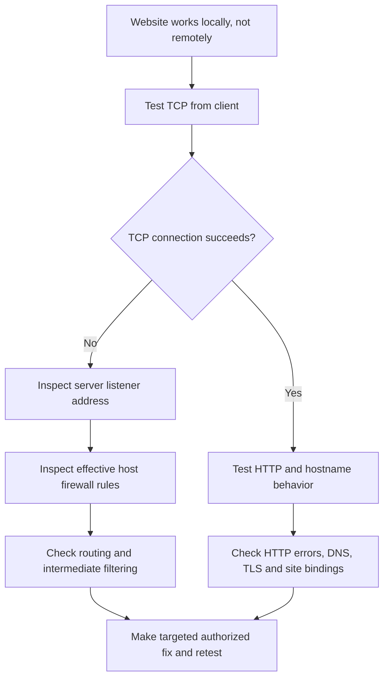

# NCCDC Windows Troubleshooting: Scenario 2 Review & Scenario 3 Practice

**Topic:** Troubleshooting a remotely inaccessible IIS website  
**Level:** Beginner to intermediate  
**Focus:** Read-only diagnostics before changing firewall, routing, or service configuration

> **Use case:** The website works locally on a Windows web server, but a computer on another network cannot connect to TCP port 80. This exercise teaches how to interpret ICMP vs. TCP results and how to investigate without bringing down scored NCCDC services.
>
> **Lab only:** IP addresses and command outputs are fictional. Perform tests on systems you are authorized to administer. Investigate and record evidence before making changes.

## Contents

1. [Scenario 2: Symptoms and your answer](#1-scenario-2-symptoms-and-your-answer)
2. [What the test results prove](#2-what-the-test-results-prove)
3. [Answer review: Why each option is right or wrong](#3-answer-review-why-each-option-is-right-or-wrong)
4. [PowerShell diagnostic commands and when to run them](#4-powershell-diagnostic-commands-and-when-to-run-them)
5. [Scenario 3: Continue investigating (no answer shown)](#5-scenario-3-continue-investigating-no-answer-shown)
6. [NCCDC troubleshooting habits](#6-nccdc-troubleshooting-habits)

---

## 1. Scenario 2: Symptoms and your answer

**Incident:** A company's website is accessible on its own Windows server, but not from another department's client computer.

| Detail | Observation |
|---|---|
| Client IP | `192.168.10.25` |
| Web server IP | `192.168.20.10` |
| Website port | TCP `80` |
| Test on web server | Local HTTP test returns `200 OK` |
| Test on client | Ping succeeds; TCP connection to port 80 fails |

**Command run on the client:**

```powershell
Test-NetConnection 192.168.20.10 -Port 80
```

**Illustrative output:**

```text
ComputerName     : 192.168.20.10
RemoteAddress    : 192.168.20.10
RemotePort       : 80
SourceAddress    : 192.168.10.25
PingSucceeded    : True
TcpTestSucceeded : False
```

**Your choice: C — Change the server's default gateway immediately.**

**Grade: Incorrect (0/1).** The best next investigation is **B — Inspect the server's listening address and effective inbound firewall rules, while considering network filtering.**

Why? The server returned an ICMP echo reply, but the TCP handshake to port 80 did not succeed. A firewall rule, listening/binding issue, or intermediate network control could explain that difference. Nothing here justifies changing a gateway yet.

## 2. What the test results prove

| Evidence | What it **does** tell you | What it **does not** tell you |
|---|---|---|
| `PingSucceeded: True` | An ICMP echo request got a reply from the target address. | That TCP port 80 is open or the website works. |
| `TcpTestSucceeded: False` | The client could not complete a TCP connection to port 80. | That the Windows Firewall specifically caused it. |
| Local HTTP `200 OK` | The particular local HTTP request succeeded. | That the website is reachable from a different network or that all pages work. |

**Mental model:** ICMP reachability, TCP connectivity, and HTTP functionality are separate checks. Do not treat one success as proof that the others succeed.

## 3. Answer review: Why each option is right or wrong

### A. Flush the DNS cache immediately — Incorrect

The failing test used an **IP address**, not a hostname. DNS was not required to determine the destination of this test.

**When to investigate DNS:** The client connects to `192.168.20.10` successfully but fails when using `portal.example.test`, or the hostname resolves to an unexpected address.

```powershell
Resolve-DnsName portal.example.test
```

If necessary, compare the answer from the expected DNS server:

```powershell
Resolve-DnsName portal.example.test -Server 192.168.10.53
```

### B. Inspect listening address and firewall rules — Correct

Check whether the server is listening on the intended network interface and whether policy permits the client's traffic.

```powershell
# Run on the Windows web server
Get-NetTCPConnection -State Listen -LocalPort 80
Get-NetConnectionProfile
Get-NetFirewallProfile -PolicyStore ActiveStore
Get-NetFirewallRule -PolicyStore ActiveStore -Direction Inbound
```

For a port-specific inventory of *some* matching firewall rules:

```powershell
Get-NetFirewallPortFilter -PolicyStore ActiveStore |
    Where-Object { $_.Protocol -eq 'TCP' -and $_.LocalPort -eq '80' } |
    Get-NetFirewallRule |
    Select-Object DisplayName, Enabled, Direction, Action, Profile
```

**Caution:** This simple filter does not necessarily show rules that cover ranges or all ports. Also check address scope, interfaces, application-specific rules, and network devices where appropriate. An enabled firewall is not inherently a problem.

### C. Change the server's default gateway — Incorrect

A missing or incorrect **return route** can break connections, so routing is worth investigating when evidence points there. But the current ICMP success does not support an immediate gateway change.

**Inspect first; do not change anything:**

```powershell
Get-NetIPConfiguration
Get-NetRoute -AddressFamily IPv4
Find-NetRoute -RemoteIPAddress 192.168.10.25
```

Run these on the **server** to examine how it would reach the client. To see the client's path toward the server, use the same route tools on the **client**, with `192.168.20.10` as the destination.

**When routing is a higher priority:** The device has an unexpected IP/gateway, the destination is on a different subnet with no usable route, or evidence suggests asymmetric return traffic.

### D. Disable all firewall profiles — Incorrect

This is a broad security change that can expose unrelated services to the Red Team. In NCCDC, keeping critical services *and* their defenses intact matters. Inspect policy first, then make a narrowly scoped, authorized fix only if needed.

## 4. PowerShell diagnostic commands and when to run them

| Command | Run from | When to implement it | What to check |
|---|---|---|---|
| `Test-NetConnection 192.168.20.10 -Port 80` | Client | First remote TCP reachability check | `TcpTestSucceeded` |
| `Get-NetTCPConnection -State Listen -LocalPort 80` | Server | Remote TCP fails, local website may work | Listener `LocalAddress`, `LocalPort`, and `OwningProcess` |
| `Get-NetConnectionProfile` | Server | Before interpreting Windows Firewall behavior | Active network category |
| `Get-NetFirewallProfile -PolicyStore ActiveStore` | Server | Need effective host firewall policy | Enabled state and default directions |
| `Get-NetFirewallRule -PolicyStore ActiveStore -Direction Inbound` | Server | Need the actual inbound firewall rules | Rule action, enabled state, profiles, filters |
| `Get-NetIPConfiguration` | Client or server | Suspect incorrect address, gateway, or DNS configuration | Adapter IP and default gateway |
| `Get-NetRoute -AddressFamily IPv4` | Client or server | Suspect no route or incorrect next hop | Destination prefixes and next hops |
| `Find-NetRoute -RemoteIPAddress <IP>` | Client or server | Need to know which local route Windows selects | Chosen interface/source/route |
| `Resolve-DnsName portal.example.test` | Client | IP works but hostname fails | Returned IP address(es) |

### Quick workflow



## 5. Scenario 3: Continue investigating (no answer shown)

Stay in the same incident. You have access to the Windows web server.

**Established observations:**

- Local website test: `200 OK`.
- Remote ping: Successful.
- Remote TCP port 80 test: Failed.

You now run on the **web server**:

```powershell
Get-NetTCPConnection -State Listen -LocalPort 80 |
    Select-Object LocalAddress, LocalPort, State, OwningProcess
```

**Illustrative output:**

```text
LocalAddress LocalPort State  OwningProcess
------------ --------- ----- -------------
127.0.0.1    80        Listen 4132
```

**Question:** What should you investigate next?

- **A.** Inspect the IIS website bindings to determine which IP address the web application is configured to use.
- **B.** Clear the DNS cache because the client cannot access the website.
- **C.** Change the default gateway on the Windows server.
- **D.** Restart the entire server because the web service must have crashed.

**Your answer:** ________

**Your reasoning:**

1. What does `LocalAddress` tell you? ________
2. What does `OwningProcess` represent? ________
3. Which fact most strongly informs your next step? ________
4. What read-only command would you run next? ________

> **No answer key for this round:** Keep the diagnosis unanswered until you have made your choice. The output is a simplified teaching example; on an IIS installation using HTTP.sys, a listener's owning PID can reflect the HTTP.sys system process rather than a separate website worker process.

## 6. NCCDC troubleshooting habits

1. **Observe:** Record the exact error, affected service, source machine, destination IP, and port.
2. **Separate layers:** Check name resolution, route, TCP, TLS/HTTP, and application behavior individually.
3. **Interpret carefully:** A successful ping does not prove a functioning website, and a failed TCP connection does not prove a host firewall block.
4. **Prefer read-only commands:** Find evidence before changing firewall rules, gateways, or services.
5. **Make the smallest authorized change:** Preserve unrelated competition services.
6. **Verify from the failing client:** A local `200 OK` cannot substitute for remote confirmation.
7. **Document:** Note the original state, diagnostic output, change made, and verification result.

---

**Related guide:** [`nccdc-windows-network-troubleshooting.md`](nccdc-windows-network-troubleshooting.md)  
**Study reference:** *CCDC Team Preparation Guide*, p. 8 (perimeter security, networking, Windows, and general administration).  
**Helpful documentation:** [Microsoft Learn: Test-NetConnection](https://learn.microsoft.com/en-us/powershell/module/nettcpip/test-netconnection), [Get-NetTCPConnection](https://learn.microsoft.com/en-us/powershell/module/nettcpip/get-nettcpconnection), [Get-NetFirewallRule](https://learn.microsoft.com/en-us/powershell/module/netsecurity/get-netfirewallrule).
